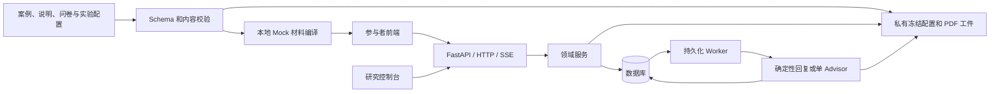

# 项目架构与维护边界

本文说明当前实现；启动与操作见 [后端说明](../backend/README.md)、[前端说明](../frontend/README.md)。接口字段以 [HTTP 协议](http-protocol.md) 和 `contracts/` 为准，案例维护见 [内容维护指南](content-maintenance.md)。

## 目录职责

| 目录 | 当前职责 |
| --- | --- |
| `frontend/` | React / TypeScript 参与者页面、研究控制台、Gateway 与浏览器测试 |
| `backend/app/` | FastAPI、业务服务、数据库、配置冻结、Advisor、Worker、回放和研究导出 |
| `backend/config/` | Advisor Prompt、工具参数和当前策略目录的默认配置；控制台文本覆盖保存在数据库 |
| `backend/migrations/` | Alembic 数据库升级脚本，属于运行依赖 |
| `backend/runtime/` | 本地数据库、密钥与私有工件；不纳入 Git，不公开静态发布 |
| `cases/` | 按稳定案例 ID 管理的参与者 YAML、保留的 Markdown、PDF 与 LaTeX |
| `shared/` | 公共说明、英文量表文案及独立 Profile 题项 |
| `studies/` | 任务、语言与流程配置；`fixtures/` 仅提供本地 Mock 编码 |
| `contracts/` | 输入和公开运行 Schema、生成的 TypeScript DTO、Gateway 服务约定 |
| `research/` | 来源、答案依据、译审和当前核对记录；不进入参与者 DTO |
| `tools/` | 内容校验、同步、材料打包、类型生成和 PDF 工具 |
| `docs/` | 当前架构、维护与运行说明；历史方案通过 Git 查看 |

所有 Python 依赖统一维护在根目录 `requirements.txt`，使用 Python 3.12+。本地推荐激活 Conda `FCMScenario`。npm 和 HTTP 浏览器测试共用 `tools/run_python.py`，解释器按 `FCM_PYTHON`、已激活的 `CONDA_PREFIX`、当前 Python 3.12+ 的顺序选择；显式配置无效时直接报错。项目不再维护两套本地 `.venv` 或机器专属路径。Docker 使用已安装同一份依赖的 Python 3.12。

## Case、Task 与 Attempt

- Case 是案例材料，按语言和内容版本维护；`case_id`、`scenario_id` 和选项 ID 保持稳定。
- Task 模板在 study 中定义，`task.id` 对应后端 `task_code`；每位参与者获得独立的个人任务 UUID，即前端 `TestTask.id`。
- Attempt 是一次实际尝试，对应前端 `Session.id`。刷新、重连沿用原 attempt；放弃后重做创建新 attempt，历史记录保留。
- 用户 `Message.id` 绑定该 attempt 的 turn，重复受理不创建新运行；供应商请求编号、业务 turn 编号和后台 job 编号分别保存。

当前工作树不再包含旧 20 例及其兼容索引。新案例通过 research/candidates/ 审核后，以英文 case.en.yaml 和 legacy_mode: none 进入 catalog；正式 PDF 只随参与者确需查看的材料进入 cases/。旧版由 Git 标签 legacy-20-cases 保存。

## 运行与数据流

开发前端默认 Mock，使用公开开发编码和标签页存储；HTTP 模式及生产构建使用服务端状态。生产页面不打包全案例材料、PDF、研究者资料或 Mock 编码，材料通过授权接口提供。编译目录 `frontend/public/materials/`、`frontend/src/generated/` 和 `frontend/dist/` 不纳入 Git；恢复旧会话所需的材料快照不作为清理目标。

后端将场景、共享文案、Profile、PDF、模型连接、Prompt、工具、目标、选项顺序和流程配置冻结后引用。后续作者编辑、模型设置变更、刷新、重做或换码不改写既有安排。公开材料与私有目标、答案、模型凭据分别过滤。

## 持久化与流程

当前为 Python 模块化单体：FastAPI / Pydantic、SQLAlchemy / Alembic 和数据库作业 Worker。本地 SQLite 已验证；PostgreSQL 驱动、迁移和 Compose 配置已提供，实际并发验收仍待完成。Redis、Celery 和 SQLAdmin 尚未接入，不作为本地启动依赖。

| 业务表 | 保存内容 |
| --- | --- |
| `participants` | 参与者身份、一次提交的 Profile 及题目版本 |
| `participant_tasks` | 测试码绑定、条件、批次、配置引用、授权版本和整次安排状态 |
| `tasks` | 个人任务、固定目标与选项顺序、全部 attempts / turns、测量和运行指针 |
| `admin_audit_logs` | 管理操作及必要的对象、变更和结果 |
| `system_jobs` | 对话、Advisor 验证、预算、配额方案、管理会话等按 kind 区分的记录 |

另有 Alembic 自身的版本表。任务 JSON 和大工件分别保存；模型网络调用在数据库事务外执行，领取、检查点和结果提交使用短事务。数据写入校验归属、阶段、幂等键和当前执行权。数据库是记录源，SSE 用于观察已保存的公开快照，不承诺逐 Token 精确重放。

Profile 每码一次，提交后才能开始任务。初始和最终判断均为 A/B 与空白起始的 0–100 整数置信度；HTTP 中测和额外后测关闭。完整保存的一次用户消息与正式回复才计为一轮，开场白、内部调用和部分失败不计数。最少 3 轮后可主动结束，默认第 20 轮完整保存后进入最终判断；完成确认重试返回同一回执。

普通发码保留自由选择任务；配额随机分配按冻结序位逐项解锁。开始后锁定任务，后台防止同一参与者并行开始不同任务。退出清除当前可恢复进度并关闭旧 attempt，后台保留原始证据；迟到回复不能推进新 attempt。换码保留进度并撤销旧授权。

条件、目标与展示顺序是不同字段。Neutral 不向模型发送后台比较目标，Goal 才包含目标。现有开发目标和平衡规则不代表正式参考答案已经审核；新 FinDRIFT 案例遵循 [案例编写规范](case-authoring.md) 和人工审核。选择分析使用稳定选项身份，不把显示位置当作 A/B 身份。

## Advisor、控制台与研究交付

真实 Advisor 已支持当前案例和冻结 PDF 的本地材料联调，由同一模型执行准备、资料工具、策略提交和正式回复。上下文白名单、策略协议、版本验证、累计预算和失败恢复见 [Advisor 运行说明](advisor-runtime.md)。当前不提供公网搜索、托管 File Search 或 Code Interpreter。

研究控制台是独立 `admin.html`，始终访问真实管理 API。已提供登录、总览、发码、换码、取消、批次、配额方案、提示词与策略卡维护、模型设置与验证、全部尝试回放及研究 ZIP 导出。提示词编辑带版本与审计，影响新建配置；已冻结配置保持原文。管理端业务变更走授权服务并写审计，回放只读已存记录。接口见 [HTTP 协议](http-protocol.md)，分配与导出分别见 [配额随机分配](quota-allocation.md)、[研究导出](research-data-export.md)。

测试码校验摘要与加密原码分开存储，只有授权管理接口返回原码；参与者凭据绑定身份、授权版本和期限。PDF 请求同样验证归属。数据库、工件和相应密钥需要一同备份；密钥不进入前端、公开 DTO 或研究导出。

## 正式运行前的待办

正式 Profile、目标语言材料、审核后的目标规则、Prompt / ToolBox 和分析口径仍需研究者冻结。原始测量、对话、失败、放弃和重做记录保留，质量标记不自动代表科学有效性；后处理不得覆盖原始数据。

PostgreSQL 并发、部署、HTTPS、备份恢复、负载和目标语言 Pilot 需单独验收。早期方案提出的 100 在线、30 个并发对话运行和 200 模拟连接属于待验证容量目标；当前真实 Advisor 全部署串行执行，不据离线功能测试承诺吞吐。配置发布与差异审核、运营工具和队列扩展按实际研究需求另行设计。
