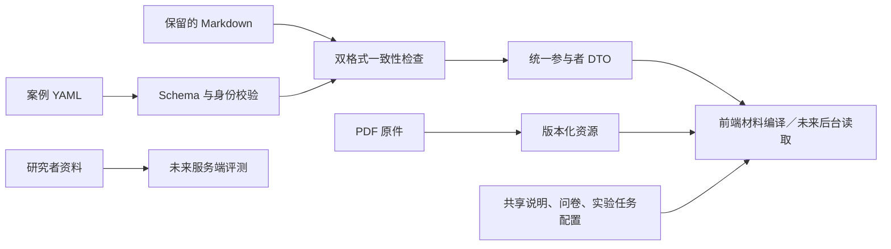

# 项目结构与后端边界

## 当前结构

```text
FCMScenario/
  frontend/                  React 页面、操作文案、Gateway 适配与浏览器测试
  backend/                   实验 API、数据库迁移、确定性 Worker 与集成测试
  cases/
    catalog.yaml             当前案例与语言入口
    01_Fund_Shares/
      case.zh-CN.yaml        新结构化格式
      material.md            原格式保留、要求显式同步
      notes.md               原研究者说明保留，不发布
      *.pdf                  原 PDF 保留原路径
      latex/                 原正式 LaTeX 保留原路径
  shared/
    instructions.md          中文公共说明原件
    copy/en.yaml             英文公共译稿
    questionnaires/          独立 Profile 题项
  studies/                   任务集合、资源与流程策略
    fixtures/                本地公开开发编码
  contracts/
    schemas/                 语言中立的输入与运行 JSON Schema
    generated/types.ts       从 Schema 生成的 TypeScript DTO
    gateway.ts               应用服务能力约定
  research/                  原始来源、译审、评分依据、核对记录
  tools/                     校验、同步、编译、生成类型与 PDF 工具
    tests/                   内容和兼容性测试
  docs/                      架构与操作指南
  build/                     生成／核对产物，不手工维护
```

本轮避免搬动 42 份 PDF、42 份正式 LaTeX 及原 Notes，以免破坏材料链接、历史版本与 PDF 工具。后续新语言的文件可以放到案例目录下 `documents/en/`，现有中文文件不需要为目录美观而复制第二份。

## Case、Task、Session

- Case：参与者材料和选项，按语言及内容版本维护。
- Task：某项实验安排的任务，引用 case，具有独立任务 ID 和参与者可见编号。同一 case 可被多个任务引用。
- Session：某位参与者开始任务后的实际作答、对话和阶段进度。

作者修改案例不会修改既有 Session。已开始会话继续使用冻结的 Scenario／SharedCopy／PDF 与版本；新的会话读取新快照。任务完成状态、真实编码、参与者答案和隐藏条件不属于 case 文件。

## 数据流



只有已声明的参与者字段进入 DTO。研究者资料不能经静态目录一并发布。编译后的 `frontend/public/materials/` 与 `frontend/src/generated/` 不纳入 Git；旧材料快照不被删除，以支持已有会话恢复。

## 前后端接入

`contracts/schemas/runtime.schema.json` 是运行数据规范，TypeScript 类型自动生成。`contracts/gateway.ts` 是服务能力列表；前端原 import 路径保留为兼容导出，后端无需依赖任何 React 文件。

当前同时提供本地 Mock 与 HTTP 模式。HTTP 后端采用 FastAPI/Pydantic、SQLAlchemy/Alembic，数据库保存五张表；本地 SQLite 已联调，PostgreSQL Compose 配置待实际环境验收。确定性 Worker 用于检验排队、SSE、保存和恢复，真实 Agent 接入属于后续批次。前端共享页面，通过 Gateway 接入权威状态。协议见 [HTTP 协议](http-protocol.md)，启动见 [后端说明](../backend/README.md)。

开发编码从 `studies/fixtures/` 编译到本地 Mock，真实参与者编码和绑定留在数据库。Profile 配置从 `shared/questionnaires/` 读取，按当前约定每个编码提交一次，保持独立任务。

研究控制台为独立 `admin.html` 入口，React 代码位于 `frontend/src/admin/`；共享视觉基础，始终通过真实 `/api/v1/admin` 获取数据，不读取参与者 Mock。`backend/app/admin.py` 负责管理会话和只读联查；发码、换码、取消复用既有领域服务及同事务审计。控制会话使用 system_jobs 的独立 kind，保持五表结构。首批提供总览、访问管理与历史尝试回放；配置发布、研究数据导出和沙盒等仍待后续实现。

## 过渡兼容

`research/case_index.json` 继续支持旧 Markdown／PDF 工具；新目录以 `cases/catalog.yaml` 为入口。原 20 例使用 verify 模式，需要双格式一致。未来新案例或译审后的新语言可使用 none 模式，直接按 Schema 读取，不再依赖固定中文表头。

任何文件同步都需显式指定方向。日常启动、构建、检查不会覆盖作者源文件。材料工具优先使用已激活的 Conda 环境，未激活时兼容项目 `.venv`。HTTP 发码时将材料和 PDF 冻结到私有工件存储，已发放安排不会读取修改后的作者文件。
