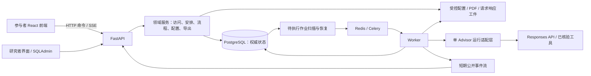
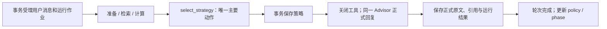

# 后端设计方案：研究协议、现有前端与实现边界

日期：2026-10-19。状态：设计方案及执行基线；第一、二批已实现实验流程、HTTP/SSE、五表迁移与确定性 Worker；管理端首批已完成登录、总览、发码/下载/换码/取消、分页筛选、Profile 和全部 attempts 回放。运行说明见 backend/README.md，协议见 docs/http-protocol.md。真实 Advisor、其余管理模块与正式部署仍待后续批次；Notion 原文未修改。

本轮范围调整：取消额外后测问卷及对应页面、必填节点和接入工作，保留既有最终 A/B 选择与置信度测量，下文的 post/后测数据仅指这次最终判断。用户随后授权一并处理前端呈现并验证效果。

建议沿用当前 Notion 的 Python 模块化单体方案：FastAPI + Pydantic、PostgreSQL + SQLAlchemy + Alembic、OpenAI Agents SDK + Responses API、Celery + Redis、受控工件存储。参与者端和研究者端共用业务服务与数据库；Advisor 只有一个。实施重点是把实验分配、流程、运行与原始证据连成可靠闭环。

## 1. 设计依据与研究目的

本次读取的 Notion 文档包括：

| 文档 | 对本方案的作用 |
| --- | --- |
| [Agent后端｜SDK、工具与运行方案](https://app.notion.com/p/3fc3854bbee981fca932ebbb981319df) | 当前工程范围、五张表、运行协议、管理平台与容量目标 |
| [Agent前端](https://app.notion.com/p/3fc3854bbee980bb8ec8f5361444274b) | v0.6.29 软件现状及尚未实现部分 |
| [2/3. 实验设计 & 创新点](https://app.notion.com/p/3f63854bbee9803bb028d6d934a8e95f) | RQ1–RQ3、条件、决策与置信度、异质性和策略分析 |
| [4. Benchmark](https://app.notion.com/p/3f63854bbee980fcb9d4d70502d06995) | 金融情境、两类评价结构、22×2 覆盖目标 |
| [Scenario](https://app.notion.com/p/3fa3854bbee98011b092e78520969136) | 案例与参与者材料、研究者说明的边界 |
| [ToolBox](https://app.notion.com/p/3fa3854bbee980c39c9be3be940a4bb7) | S00–S14 定义、选择与实现的区分 |
| [5. Experiment](https://app.notion.com/p/3f73854bbee98016b6f5ce2071a6c1ef) | 真人实验与模型侧评测的区分、分析单位 |
| [Data & Logging｜数据收集规范](https://app.notion.com/p/3e93854bbee981bc8a91f69032d8fff7) | 原始数据、版本、后处理和异常的分层 |
| [案例编写规范｜Codex 执行说明（OECD）](https://app.notion.com/p/3fa3854bbee981e7894ef82f5b4c3453) | 客观题目标、材料权限、案例审核和稳定选项身份 |
| [Experiment Frontend｜前端交互设计](https://app.notion.com/p/3f23854bbee9816cb942f9624a46a050) | 历史交互方案，结合当前文档识别已变更约定 |

代码核对范围为 README、docs/architecture.md、backend/README.md、contracts、studies/local-development.yaml、Profile 配置、前端 Gateway/Mock、入口与流程状态、提交逻辑、材料与判断组件。查看了仓库保存的历史页面截图；本次没有重新运行浏览器交互检查。前端 npm test 重新执行，26/26 通过，所覆盖的仍是本地 Mock 与前端行为。

研究需要同时支持三个层面：

- RQ1：案例与工具协议是否能稳定支持评测；现有 20 个案例不等于 44 个主案例已建设完成。
- RQ2：参与者层面 Neutral/Goal 分配，观察任务前后选择及主观置信度变化，并与背景问卷关联。
- RQ3：记录每轮主要策略、真实回复、工具和内部调用，分析偏好与转换；策略选择不等于策略实现，也不能直接识别单项策略的因果效果。

因此原始数据保留 Participant → Task → Attempt/Episode → Turn 层级。真人对话、沙盒和后续模型受控评测须明确区分。

## 2. 文档差异的处理

当前后端页明确规定物理存储和运行约定以其为准；当前前端报告描述已实现行为。旧论文稿作为研究依据，不据其恢复已经关闭的功能。

| 差异 | 本方案的工程基线 |
| --- | --- |
| 旧稿 Profile 在末尾；当前前端在任务开始前 | 每码一次，提交后才允许开始任务 |
| 旧实验稿启用随机中测；当前后端关闭 | 正式配置 probe_enabled=false，不创建中测记录；开发夹具可继续检验旧能力 |
| 旧稿优先每人一案例；当前后端允许每码多任务 | 支持变长必做清单；单案例是其特例。研究分析保留参与者聚类与实际开始顺序 |
| 主实验稿 RQ2 固定 M0；后端允许逐任务匹配模型 | 平台支持模型矩阵；建议主实验发布校验固定 M0，其他模型安排到独立研究批次，研究者也可显式发布其他设计 |
| 后端写候选目标等概率抽取；案例规范规定客观题诱导错误项 | 客观题候选集只含审核后的错误项；权衡题候选集为 A/B。缺少私有目标规则时禁止正式发布 |
| 旧数据规范对 ADS 的口径与当前 A/B+置信度研究稿不同 | 数据库只存原始选择、置信度和目标；导出指标采用显式版本化定义，不能直接沿用旧 allocation 口径 |
| 前端“退出清除进度”；研究日志要求保留原始数据 | 清除参与者当前可恢复进度；后台关闭并保留旧 attempt，不物理删除 |
| 后端包含内置后测；当前 UI 仅实现最终 A/B+置信度 | 本轮取消额外后测问卷，保留最终判断；不新增后测问卷页面或必填节点 |

后端页同时存在“策略目录暂未生成、预留接口”和“完整接入策略选择”的表述。建议现在实现协议、校验和数据结构，将经过核对的 ToolBox 目录文件与 Prompt 作为独立发布工件；未具备完整目录的配置可做技术调试，不得被标记为正式策略实验。

## 3. 系统组成与代码组织



API 负责校验、受理、查询与输出过滤；Worker 执行长耗时模型和批量作业；数据库决定是否已经开始、是否完成以及能否进入下一阶段。Redis 用于队列、短期流和并发控制，不是实验记录源。

建议目录：

```text
backend/
  app/
    main.py
    api/participant.py, admin.py, streams.py, resources.py
    domain/access.py, assignment.py, workflow.py, instruments.py
    agent/runtime.py, prompts.py, strategies.py, capabilities.py
    persistence/models.py, repositories.py, schemas.py
    jobs/tasks.py, dispatcher.py, recovery.py
    artifacts/store.py, config_registry.py
    admin/views.py, replay.py, exports.py
    core/settings.py, auth.py, errors.py
  migrations/
  tests/
  pyproject.toml
  <锁定依赖文件>
```

按真实职责组织模块，共用领域服务，不把管理端逻辑复制一套。沿用 tools/case_content.py 等内容校验能力；后端不导入 React 文件。

## 4. 数据模型与标识

保持现有三张核心表与两张辅助表。完整字段以 Notion 当前后端页为依据，本方案补足映射和一致性规则。

| 表 | 核心内容 |
| --- | --- |
| participants | participant_id、一次提交的版本化 profile |
| participant_tasks | 与 participants 共主键；测试码校验值与加密原码、access_version、study/batch/config_ref、condition、测试状态和时间 |
| tasks | 每名参与者实际任务 UUID、task_code、scenario_id、model_ref、目标、选项顺序、status、task_data、runtime_state、revision |
| admin_audit_logs | 操作人、时间、动作、对象、必要字段差异、原因和结果；追加记录 |
| system_jobs | 运行/导出/发码等作业、幂等键、状态、进度、租约、结果工件与错误 |

命名映射必须在契约中写清：

- study YAML 的 task.id 是任务模板编号，对应 task_code；正式 tasks.task_id 是每份安排单独创建的 UUID。不能把开发夹具的共享 ID 当成所有参与者共用的执行记录 ID。
- 前端 TestTask.id 对应 tasks.task_id；number 对应参与者可见的任务编号。
- 前端 Session.id 建议直接使用 attempt_id。任务重做产生新 Session.id，刷新与重连沿用原值；无需增加 Session 表。
- 客户端 Message.id 作为本次提交的稳定标识，由服务端绑定该 attempt 的 turn_id；同 ID 不同正文拒绝，不按文字内容去重。
- system_jobs.job_id 是一次运行作业标识；供应商 response_id、trace_id 和业务 turn_id 分别保存。

task_data 保存 schema_version、attempts；每个 attempt 保存状态、阶段、时间、前后测、turns 和必要流程事件。每个 turn 保存用户原文、助手原文/部分内容、selected_strategy、tool_calls、model_calls、用量和异常。大请求、结果及附件保存不可变工件引用和哈希。runtime_state 保存当前 attempt/turn、运行租约关联和 SDK 历史续接状态，参与者 DTO 与研究导出分别过滤。

数据库约束包括：test_code_hash 唯一；participant_id+task_code 唯一；同一 participant_id 最多一个 in_progress task 的条件唯一索引；状态和 revision 的约束。开始任务先锁整次测试安排行，统一锁顺序，避免并发开始两个不同任务。

所有任务写入采用短事务、行锁或 revision 条件更新；对 JSONB 使用显式更新或重新赋值经校验的完整对象。发生冲突重读后按目标 attempt/turn 合并，不能只改 revision 重发旧 JSON。材料展开事件也须走同样的写入边界，避免覆盖对话。模型调用期间释放数据库事务。

在 JSONB 方案下不逐 Token 改写整项任务。原始消息、工具结果、策略和回复保存为阶段检查点，流式部分内容按有界缓冲定期保存；永久记录保留最终文本、异常及必要的部分内容。按真实数据大小压测行更新、导出和文本查询，不能仅凭五张表少就认定性能充足。

## 5. 配置发布与随机分配

新增不可变发布包，沿用作者维护的 cases/shared/studies/research 边界：

- public 部分：案例 DTO、共享文案、参与者 PDF、表单题项。
- private 部分：目标候选规则、答案与审核依据引用、模型/Prompt/ToolBox/工具预算、研究协议和采集配置。
- manifest：各对象哈希、语言、UI/Schema 版本及模型能力核验结果。

现有配置缺少 model_ref、max_turns 和正式目标规则，需扩展服务端配置契约。额外后测问卷本轮取消，不为其增加 Schema 或发布要求。研究者资料不能加进公开 runtime DTO。建议为私有研究配置单独建 Schema，扩展现有 study Schema 只承载双方需要的字段。

发码流程为“预览安排与预算 → 校验发布包和任务矩阵 → 幂等确认生成 → 下载结果”。预览采用固定计划引用，确认时校验计划哈希和有效状态，不能确认时悄悄替换案例、模型或数量。最终条件和随机结果须在创建事务中固定，预览若展示实际抽签结果，应冻结该计划。

条件在 participant_tasks 层按研究者明确选择的实验条件与各组数量创建。可指定 Neutral、Goal 或同时指定两组人数，不自动随机分组或平衡。任务模型按研究者安排保存；target_option_id 从审核后的候选集中抽取，option_order 独立随机。重做、刷新和换码不改变已固定的分配。

当前源数据 A/B 已承担稳定选项身份。第一版随机化建议只改变卡片/表格列的先后顺序，保持 A/B 与内容的映射；所有材料和提交使用稳定 ID。若研究另需交换展示字母，应增加完整 display→canonical 映射，并核对正文、比较列、PDF 和 Agent 上下文，不能只调换两张按钮。

参与者目前自由选择任务，因此记录实际启动顺序，不宣称已执行任务顺序随机化。若正式设计需要平衡顺序，另发布明确的流程配置与前端行为。

## 6. 流程状态与完成规则

整次测试：pending → in_progress → completed，另有 cancelled；过期从 expires_at 计算。

单项任务：pending → in_progress → completed；放弃当前 attempt 后可以回到 pending。attempt 保留 in_progress/completed/abandoned/failed；phase 使用 pre/dialogue/post/complete。对话运行的 queued/running/interrupted 等另放在 turn/job，不混进 task.status。

规则由 WorkflowService 执行：

1. Profile 未成功提交不能开始任务。同一任务已进行中时 start 返回当前 attempt，不能新建。
2. pre 校验 option_id、0–100 整数置信度与必填项；成功后进入 dialogue，固定开场白不计轮次。
3. 一条用户消息加一条完整、已持久化的正式回复才算一轮。内部调用、策略提交、失败或部分回复不计完成轮。
4. 完成至少 3 轮后允许主动结束；默认第 20 轮完整保存后自动进入 post。probeRequired 始终为 false。
5. 主动结束只能在无活动运行时提交，防止结束命令与新消息并发。命令结果包含权威阶段。
6. post 保存后可进入前端 finishing；completeSession 持久化完成凭证与任务完成状态，重试返回同一凭证。它不调用模型。
7. 当前任务测量仅包含前测与最终 A/B+置信度判断，不设置额外后测问卷必填条件。
8. 整次测试完成要求 Profile 和冻结任务清单全部成功完成；cancelled、失败、放弃和空清单都不作为自动成功。

放弃时原子关闭 attempt、记录原因、清理当前运行指针并请求停止作业。后台保留旧消息、测量、事件和模型结果；参与者清除当前草稿并返回列表。后续迟到响应只关联旧 attempt，不能把当前任务推进或写入新 attempt。

## 7. HTTP 与 SSE 契约建议

以下均为拟议路径，当前没有这些可调用服务。保留 ExperimentGateway 的应用服务边界，新增长运行能力。

| Gateway / 能力 | 建议 API |
| --- | --- |
| getExperimentInstructions | GET /api/v1/instructions |
| verifyTestCode | POST /api/v1/access/exchange |
| getAccessGrant / 凭证续期 | GET /api/v1/access；POST /api/v1/access/refresh |
| get/submitParticipantProfile | GET/POST /api/v1/profile |
| getTasks | GET /api/v1/tasks |
| startTask | POST /api/v1/tasks/{task_id}/start |
| resumeTask | GET /api/v1/attempts/{attempt_id} |
| abandonTask | POST /api/v1/attempts/{attempt_id}/abandon |
| submitDecision | POST /api/v1/attempts/{attempt_id}/measurements/{pre或post} |
| sendMessage 的受理 | POST /api/v1/attempts/{attempt_id}/turns |
| 查询和恢复运行 | GET /api/v1/attempts/{attempt_id}/turns/{turn_id} |
| 公开 SSE | GET /api/v1/attempts/{attempt_id}/turns/{turn_id}/events |
| endDialogue | POST /api/v1/attempts/{attempt_id}/end-dialogue |
| recordEvent | POST /api/v1/attempts/{attempt_id}/events |
| completeSession | POST /api/v1/attempts/{attempt_id}/complete |
| 受控 PDF | GET /api/v1/attempts/{attempt_id}/documents/{document_id} |

所有参与者业务请求校验短期凭证、participant_id、最新 access_version、有效期、测试状态和资源归属。Gateway 即使没有逐方法 token 参数，也必须通过统一 HTTP transport 带认证；不能把 sessionId 当认证凭证。SSE 建议用支持认证头的 fetch 流；PDF 新窗口通过受控同源会话或短效资源授权，凭证不放 URL、不暴露对象存储。

变更请求携带稳定 requestId / Idempotency-Key。保存作用域、正文哈希与受理结果：同键同正文返回同一结果；同键异正文报 409。除请求键外，Profile 和 checkpoint 还要业务级唯一：刷新生成新键后重复提交同一已接受答案可返回确认，冲突答案不得覆盖。开始、完成和退出同样按业务状态幂等。涉及运行的记录保存在对应 turn；短命令在其业务 JSON 内保存有限的命令回执；后台作业使用 system_jobs 幂等键，不新增通用命令表。

sendMessage 改为受理后返回 202 和 turn_id/job_id/status；不让 HTTP 请求一直承担模型生命周期。SSE 只包含 queued/working、正式回复 delta、citation、turn.completed、turn.interrupted、snapshot_required 等公开事件，不透传原始 SDK 流。

最终事件携带 message、policy、权威 stage、revision；只有数据库完成提交后才发 turn.completed。policy 补充 maxTurns、completedTurns、canSend、canEnd；progress 增加 activeTurn 和 queued/running/interrupted 等恢复信息，不能把后台运行中恢复成 ready。达到轮数上限根据返回的 stage 进入 post，不能靠前端消息数推测。

短期事件流带序号与 TTL，支持 Last-Event-ID 或等价 cursor；过期改用持久化快照，恢复已保存文本和活动运行状态，不承诺逐 Token 精确回放。浏览器断线后查询同一 turn；重发同 Message.id 只返回受理结果，不创建新运行。连接结束不表示对话运行结束。

统一错误体提供 code、message、requestId、权威状态和可执行的下一步。区分 401 凭证过期/无效、403 资源越权、409 阶段冲突、422 内容校验、429 临时限流及服务异常。retryable 不等于允许另建模型运行；运行受理不明时先查原 ID。

## 8. 单 Advisor 的每轮协议



复用 SDK 运行和流能力，用薄状态控制保证顺序。prepare 的普通文字不对参与者显示。select_strategy 参数只允许 strategy_id=S00…S14，由服务端绑定身份；处理器不调用另一模型。只有成功写入后才进入 reply，reply 阶段禁用工具。策略提交与其他尚未完成的工具不得并行生效。

缺少选择时只允许有上限、留痕的协议修复；不能因为调用过搜索就认为已经选择策略，不能自动补 S00。无效/重复选择记为协议错误，保留原始调用。回复实现是否符合策略留给事后编码，不在运行中按质量自动重写。

Prompt 只装配共同角色与流程、当前条件、公开案例材料、完整动作目录和当前 attempt 的真实对话/工具历史。Goal 才加入隐藏目标；Neutral 不接收后台比较目标。Profile、pre/post 答案、研究者说明不在模型输入白名单。主动在聊天中提供的信息按原对话处理。每任务/attempt 独立历史，不能跨任务共享同一个用户记忆。

建议采用 SDK 的显式历史输入/结果项进行续接，必要的工具调用/结果和不可读状态放 runtime_state，长记录可以引用私有工件；不同时启用 provider 续接和全历史重复回放。SDK 运行方式、所需状态和采集钩子在锁定版本时做小型兼容性验证。支持会话续接不代表可以恢复一个已经中断的网络生成到最后 Token。[OpenAI 运行与状态文档](https://developers.openai.com/api/docs/guides/agents/running-agents)

能力工具按当前后端决定接入：原生 Web Search、长附件 File Search、计算 Code Interpreter；必要时加 read_material 薄封装。短案例直接提供；文件检索按案例和版本隔离。两条件权限、材料和预算一致，记录实际行为差异。每轮最多 2 次/每任务累计最多 10 次搜索是当前后端设计默认，需在适配层实现计数与能力验证，不能只写在 Prompt；托管工具的调用上限语义须测试，不声称无限制的内部调用可由客户端逐次拦截。

完整动作定义、Prompt、材料和模型配置引用都须不可变。模型注册时核验 reasoning、摘要、function calling、所需托管工具及流能力；不支持所需组合时不能无提示降级或换模型。推理强度以 medium 为当前建议，在实验配置中固定，不在本方案中锁定未经验证的具体模型或库版本。

## 9. 可观测性与研究记录

每次内部调用在真正 SDK/HTTP 请求边界保存有序输入清单、工具 Schema、实际参数、版本引用、response_id、输出、用量、异常及关联 ID。固定文本去重存储；展示时展开引用。后台明确区分实际捕获的请求、从版本重建的内容和供应商未公开的内部状态。

请求支持模型的原生 reasoning summary，保存供应商原文及 available/not_supported/not_returned/partial 等状态。摘要不称完整思维链，不另外生成“当时的思考”。加密状态仅用于续接。该能力需按模型验证。[OpenAI reasoning 文档](https://developers.openai.com/api/docs/guides/reasoning)

File Search 若要保留命中内容，显式请求 include=["file_search_call.results"]；仅存最终引用不足以恢复检索结果。保留实际可得内容、文件版本、搜索时点与 URL，不承诺公网永久可复现。[OpenAI File Search 文档](https://developers.openai.com/api/docs/guides/tools-file-search)

原始用户消息、回复、策略、工具输出和测量长期保存；SDK Trace 用于关联排错，不能替代本地原始证据。客户端事件保存 client_time 与 server_received_at，去重并校验必要字段，不视为已阅读或理解。助手服务端推送与浏览器呈现确认分开记录；未确认不推断“已看到”。

离线导出包含 test/task/attempt/turn 关系、原始测量、真实模型及配置、工具结果和异常。CSV 按粒度拆开，原始完整内容用 JSON/JSONL 与工件清单提供。对原始记录的后处理标签采用单独的版本化分析工件，不覆盖原文，也不增加派生指标业务表。

当前 A/B+置信度方案可在版本化分析中采用 D(A)=-C、D(B)=+C，目标 B 时 ADS=Dpost-Dpre，目标 A 时取反；这里的 A/B 必须是稳定身份，不能是显示位置。原始数据始终保留。客观题正确性需匹配审核答案版本，权衡题不生成统一正确性。自由选择、多次尝试、失败与未完成须可导出，排除规则由研究方案预先规定。

## 10. 作业、断线与失败恢复

受理 turn 时在同一数据库事务保存用户消息、active_turn 指针和 system_jobs queued 行；提交后再通知队列。把 system_jobs 用作可扫描的待投递记录，定期补投数据库中尚未执行的 queued 作业，解决“数据库成功但发队列失败”。队列仅传 job_id。

Worker 通过数据库条件领取租约，所有写入核验 job/attempt/turn 与当前执行权。重复队列消息只返回现有状态；租约过期触发核对，不直接重发已受理状态不明的外部模型请求。应用的幂等不能保证供应商请求在任何故障窗口都恰好执行一次。

| 情况 | 处理 |
| --- | --- |
| 用户重复点击或网络重发 | 返回原 turn/job；同键异正文冲突 |
| SSE 断线 | 查询原运行、续接公开事件或读快照；不重新生成 |
| Redis 丢失队列/短期流 | 从 system_jobs 补投未执行项，参与者读持久化快照 |
| Worker 处理中崩溃 | 核对供应商 response 状态与已存检查点；未知则 interrupted，不盲重放 |
| 回复已取得但 DB 保存冲突 | 重试保存相同结果；不重复请求模型 |
| 生成中断或拒绝 | 保存原文/部分内容/原因，不算完整轮，不悄悄补回复 |
| 用户放弃，供应商迟到结果到达 | 保存到旧 attempt 的历史/异常区域，不推进当前运行指针 |
| 管理员请求停止 | 先 cancel_requested，确认停止后再 cancelled；未确认的托管调用保持可见状态 |

只有能确认未被接受的机械失败才允许有限自动重试；由运行适配层统一控制，并检查 SDK 自带重试配置，防止 SDK、队列和 HTTP 各自重试相乘。不能因回答质量或策略实现不满意而重新抽样。

## 11. 测试码、授权和材料访问

沿用密码学随机生成 16 位不易混淆字母数字码、规范化输入、唯一校验和碰撞重生成。按用户更新要求，研究者可随时查看、复制与再次导出当前测试码；存储 HMAC 校验值与 Fernet 加密原码，管理接口授权后解密返回。原码不进入应用日志或参与者 DTO。批量生成一次可指定两组数量，单批最多 1000 码；同请求重试恢复原批次及已保存测试码，不重复创建记录。

凭证绑定 participant_id、access_version 和到期时间；换码/作废递增 access_version，并使旧凭证失效。已经打开的流也应在继续输出和重要边界检查撤销状态，不能只在连接开始检查。换码不重置进度、目标、条件或已完成状态。材料请求同样核验归属和最新授权。

参与者 AccessGrant 使用 participantId + codeDisplay（不可登录的展示标识）+ accessToken + expiresAt；只有管理接口返回原码。Profile 草稿按 participantId+instrument_ref 隔离，原始输入码用于交换凭证，不放入签名访问凭据。

前端 getAccessGrant 的网络失败目前会清凭证并退回入口，正式版本应区分 401/撤销和临时网络故障；后者保留缓存与草稿、允许重连。短期凭证续期仍校验数据库状态，过期无法续期时重新输入码恢复同一记录，不生成新参与者。

公开构建仅发布页面和许可公开的说明；正式材料经受控接口读取，不将整个 cases/research 目录或全案例材料快照挂为静态目录。现有 ScenarioPanel PDF 链接使用 BASE_URL 拼接，需要改为适配受控 URL 或 Gateway 文档打开能力。后台只显示密钥配置状态/引用，不回显密钥。

## 12. 管理平台与导出

完整交付范围仍包含后端页所列十二个模块，可在以下五组工作区中组织：

| 工作区 | 覆盖内容 |
| --- | --- |
| 实验运营 | 仪表盘、实验/批次、发码预览与下载/换码、任务/模型矩阵 |
| 配置与材料 | 案例/PDF/语言版本、模型能力、Prompt/ToolBox/预算、发布/差异比较 |
| 参与与运行 | 五张表的分页联查、全部 attempts、参与者回放、逐调用上下文/原生摘要、实时运行与停止 |
| 数据与分析交付 | 缺失/异常检查、质量标记、范围预览、JSON/JSONL/CSV/字典与配置工件 |
| 开发与维护 | 独立沙盒/模型对比、作业、审计、服务状态、备份和恢复验证 |

SQLAdmin 用于通用表浏览，默认关闭直接修改原始业务记录的入口。业务变更走专用服务并在同一数据库事务写审计；发码矩阵、JSON 树、逐调用回放和上下文检查做专用页面。列表不默认加载完整 task_data；详情可加载完整 JSON 和工件，不能只有截断摘要。全文查询先通过受控 SQL/JSONB 查询实现并压测；筛选预设保存在管理配置，不增加实验事实副本。

回放只读已存记录，不请求模型；沙盒的新运行由 system_jobs 管理，产物保存到开发命名空间，与正式 participants/tasks 隔离。导出用一致快照确定范围，保存截止时间、筛选、Schema/指标版本、文件清单和哈希；大导出先在短快照事务中确定并固化输入，文件整理在事务外执行。

管理端单研究者账号沿用部署密钥配置与成熟认证组件。原始数据默认只读；质量标记、停机、换码、发布和导出都可追溯。配置与对象存储的发布采用“先写不可变工件并校验 → 再切换发布指针”；失败不破坏旧版本，失败步骤记录为作业。不得把文件写入与 PostgreSQL 更新描述为一个跨系统 ACID 事务。

## 13. 必须随接入完成的前端改动

“只替换 Gateway 工厂”适用于早期同步接入，不能覆盖当前完整后端范围。正式接入至少包括：

1. 实现 createHttpGateway，统一附带认证、错误和请求 ID；生产构建不默认进入 Mock，不携带正式入口可用的开发码逻辑。
2. sendMessage 拆为受理、订阅与查询；reducer/useExperiment 支持公开增量、排队、运行、断线、部分失败、快照恢复以及同一 ID 消息合并。
3. SessionProgress 返回 activeTurn 与权威阶段；恢复时不能把运行中任务呈现为 ready；临时错误保留原受理消息和草稿映射。
4. 最大轮数和自动进入 post：现有 MESSAGE_RECEIVED 只更新消息与 policy，不切阶段，必须修改。
5. Message 增加引用与生成状态；为公网/文件引用提供可追溯的展示，不能只保留纯字符串 text。
6. 测试码展示和 Profile 草稿改用稳定参与标识；换码后继续原档案，不开另一套草稿命名空间。
7. 统一 Scenario.options 顺序，判断卡片和材料列保持一致；恢复与重做不重新排序。
8. PDF 链接改走受控资源；任务和配置刷新从服务端获取冻结版本。
9. 取消额外后测表单开发，保留当前最终判断。当前 Profile 只是两道开发题，正式 Financial Background/AI Experience 研究测量仍需提供题项；本轮不自行改写参与者可见题目。
10. 完成页和任务列表区分任务完成与整次测试完成，服务端持久化成功后再显示确认。

runtime.schema.json 继续作为公开 DTO 的规范入口，修改后重新生成 TypeScript；Pydantic 和 OpenAPI 与其通过契约检查保持一致，避免三份结构独立漂移。内部数据库和模型请求 Schema 与公开 DTO 分开维护。

### 前端呈现与内部实现的分工

涉及参与者可见呈现、适合交给前端 Agent 的部分：

| 呈现内容 | 所需处理 |
| --- | --- |
| 流式回复 | 在原助手消息位置逐步显示正文，处理滚动和生成中状态，避免重复气泡 |
| 排队、断线、恢复和中断 | 沿用现有界面风格表达状态，明确等待、恢复或重试操作，并处理按钮禁用 |
| 回复来源引用 | 在消息内或消息下方展示可点击来源，支持网页和材料定位 |
| 编码展示 | 将完整测试码替换为脱敏显示标识，检查任务列表卡片与相关文案 |
| 完成提示 | 使用现有完成页表达本任务完成和全部任务完成，保持入口与提示清楚 |

协议/类型、认证、请求防重、运行查询与 SSE 传输、状态恢复、轮数与阶段判断、固定选项顺序的数据传递、资源授权及测试属于内部实现，可以自行处理。最大轮数触发沿用既有最终判断页，不增加页面；视觉 Agent 与内部实现通过共享契约配合，避免双方同时修改同一 reducer 或 hook。

## 14. 部署、实施顺序与验收

交付 Docker Compose：反向代理/HTTPS、前端、API/管理、Worker、Redis、PostgreSQL；工件和备份持久化到独立受控存储。既有后端页提出的 100 在线、最多 30 个并发对话运行、200 模拟连接作为待验证目标。运行槽位与供应商额度共同限流，排队时显示等待状态；先预留已开始测试的预算，预算紧张时限制新入场，不能在线切模型。

本方案不重报文档中的价格或承诺实例吞吐。主机规格、服务地区、实际模型/工具组合、API 项目额度和预算按部署时验证结果确定；备份须同时覆盖数据库、已引用工件、发布包与必要密钥配置，并验证恢复。单机候选存在单点停机，不能称为高可用部署。

以下为完整范围内部的开发顺序，每步有可检查产物，不表示删减管理端或异常恢复：

| 顺序 | 交付与验收重点 |
| --- | --- |
| 1. 规则与契约 | 五表迁移、私有配置 Schema、公开 DTO/SSE、ID 映射、状态转换、协议差异记录 |
| 2. 实验闭环 | 发布包、发码预览/下载/换码、认证、Profile、任务开始/恢复/退出、前后测、完成回执；用确定性运行替身检验 |
| 3. Agent 闭环 | 实际能力验证、单 Advisor、严格策略提交、正式流式回复、请求/结果/摘要采集、预算和会话隔离 |
| 4. 管理与研究交付 | 十二模块、五表联查、全部 attempts 回放、质量标记、沙盒、导出、作业和审计 |
| 5. 正式运行准备 | HTTP 前端联调、并发与故障注入、额度验证、备份恢复、目标语言 Pilot 与冻结发布 |

关键集成测试：两个标签页同时开不同任务只能成功一个；同一消息重发只受理一次；受理后断线不重复调用；第 3 轮可结束、第 20 轮自动进入 post；运行中恢复不得发送新轮；Profile/测量不出现在实际模型请求；Neutral 请求没有目标；重做后模型/条件/目标/顺序不变且历史隔离；退出后迟到结果不推进新 attempt；换码使旧凭证和流失效；数据库已提交但队列投递失败可恢复；Worker 在供应商受理前后崩溃不盲重发；JSON 并发写不丢记录；已提交答案不能被新 requestId 覆盖；所有必做任务完成后整次测试才完成；回放零模型调用，导出和备份可验证恢复。

正式发布前还需把正式 Profile、必要说明文本、案例审核目标候选、主实验模型配置与分析指标版本放进发布包。额外后测问卷本轮取消。上述未定内容不妨碍实现通用工程闭环，但配置缺失时不能宣称已满足正式研究投放条件。
