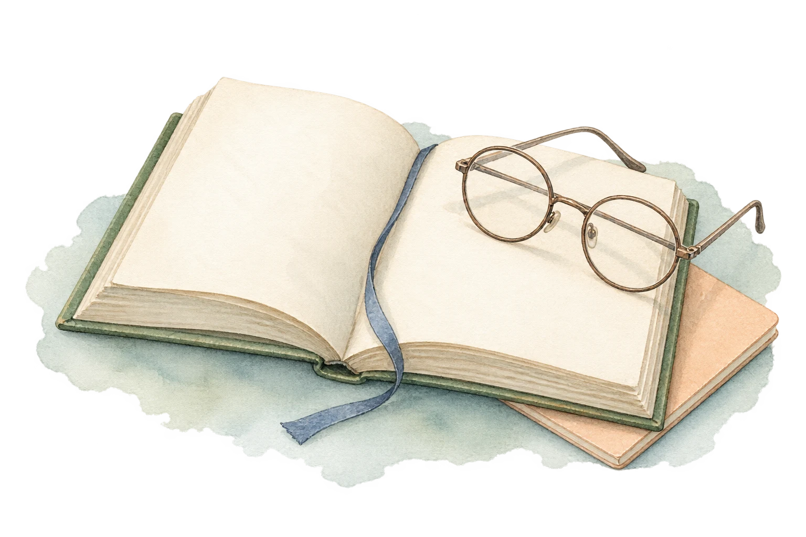
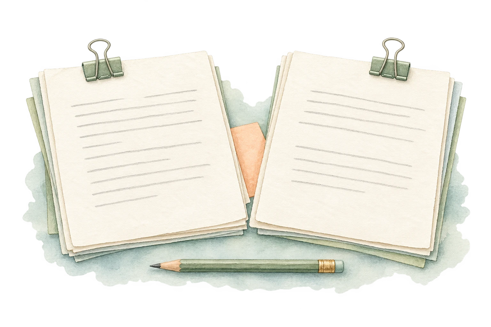
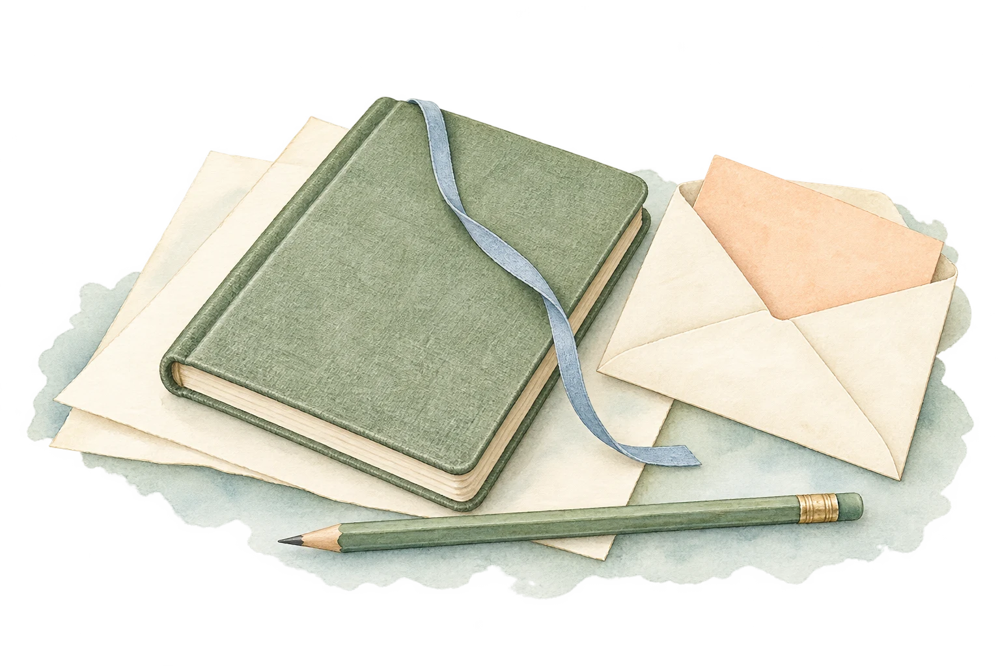

# 同系列备用插画

日期：2026-10-18。共 4 幅，延续已使用的淡水彩、暖白纸张、青绿与灰蓝，以及少量浅杏色。由内置 image_gen 制作。其中“收好记录”已自界面 0.6.1 起用于 Profile 标题区，其余三幅作为备用素材保存。

原始 PNG 均为 1536×1024，保留透明背景；web/ 中提供保留透明度的 WebP。完整提示词见 [prompts.md](prompts.md)，文件大小与 SHA-256 见 [assets.json](assets.json)。

| 名称 | 画面与建议用途 | 原稿 | 网页版 |
| --- | --- | --- | --- |
| 安静阅读 | 书页、圆框眼镜、灰蓝书签，适合阅读说明或入口替换。 | [PNG](originals/quiet-reading.png) | [WebP](web/quiet-reading.webp) |
| 对比资料 | 两份等大的资料与铅笔，适合比较材料或任务概览。 | [PNG](originals/comparing-notes.png) | [WebP](web/comparing-notes.webp) |
| 交流与思考 | 青绿与灰蓝纸质对话气泡、便签本与铅笔，适合交流主题入口。 | [PNG](originals/conversation-notes.png) | [WebP](web/conversation-notes.webp) |
| 收好记录 | 合上的笔记本、信封、书签与铅笔，适合记录或完成页面。 | [PNG](originals/filed-notes.png) | [WebP](web/filed-notes.webp) |

## 预览

### 安静阅读

### 对比资料

### 交流与思考

### 收好记录

需要应用某幅素材时，将对应 WebP 放入 public/illustrations/ 并更新 StudyIllustration 组件的引用。“收好记录”已复制为 public/illustrations/filed-notes-watercolor.webp。其余备用文件保存在 design/ 下，不会额外打包进当前页面。

